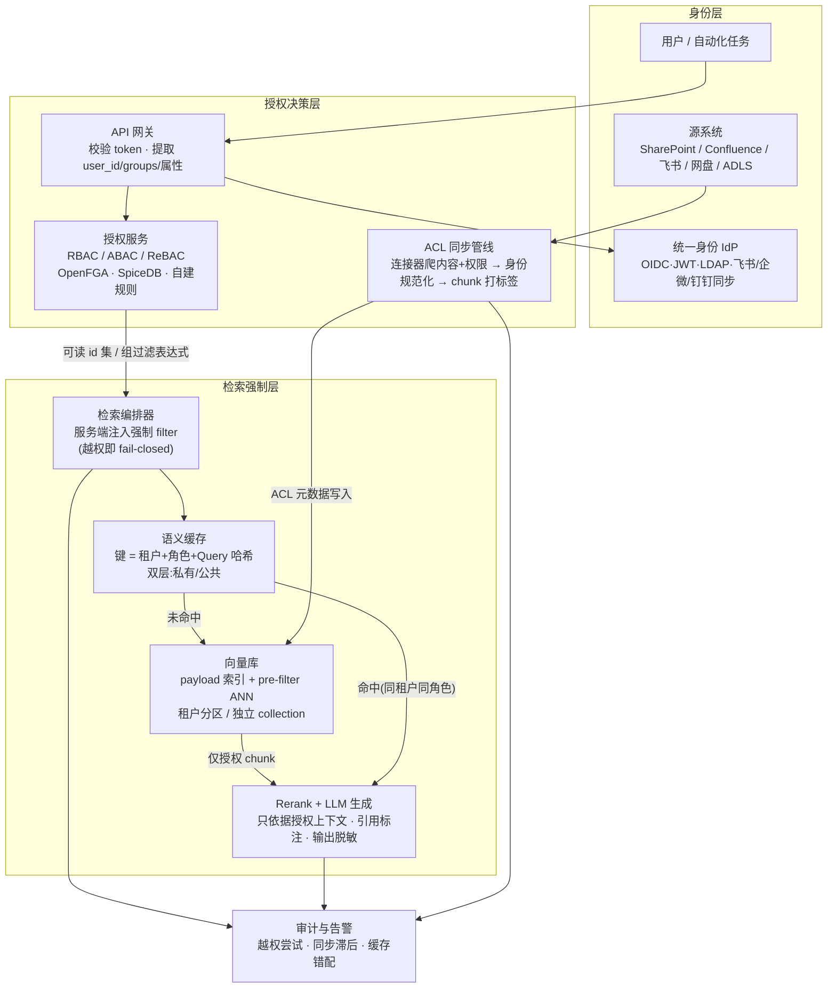
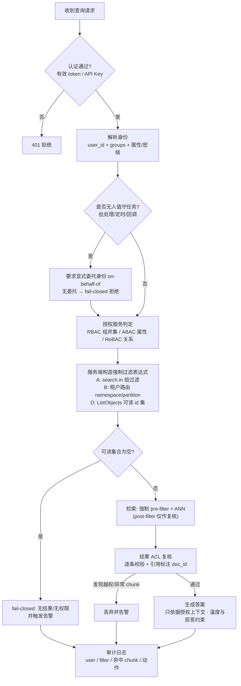
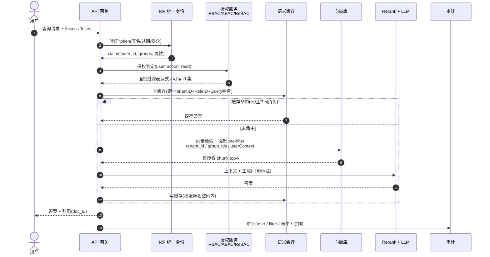
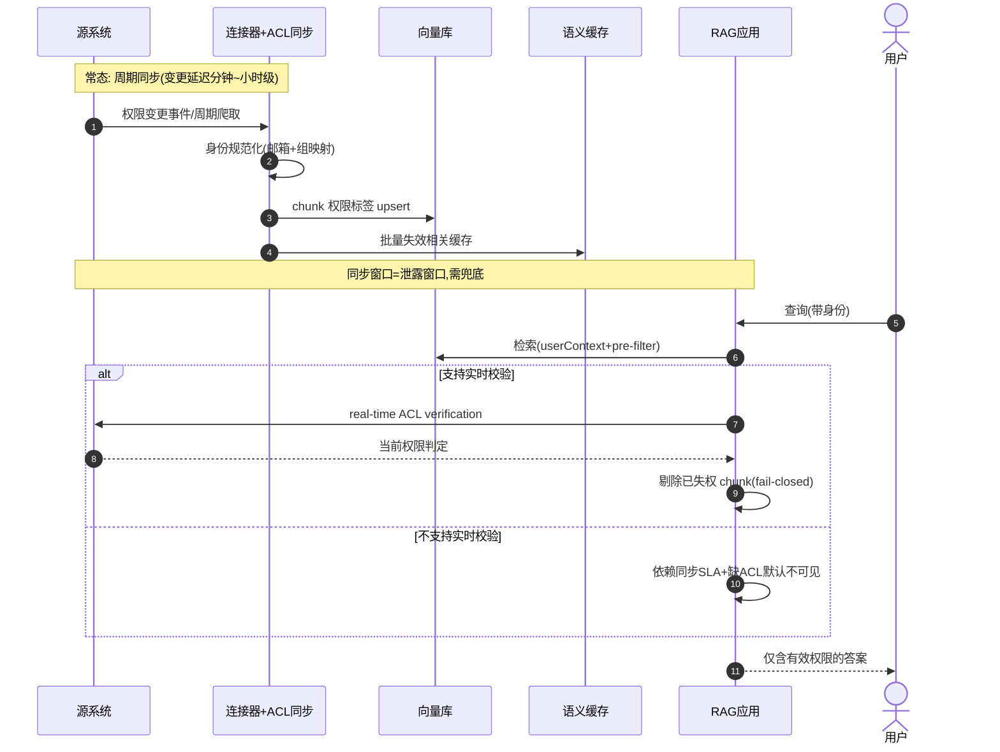

# RAG 权限管理（Permission-Aware RAG）

> 版本 v0.1 · 2026-09-27 联网调研 · 适用范围：RAG 系统的文档级/租户级访问控制——为什么朴素 RAG 必然越权、四种权限架构模式、端到端参考架构、查询授权流程、权限同步与漂移兜底、五个应用场景举例、RAG 特有安全风险。
>
> 依据来源：Microsoft/Azure/Amazon/Weaviate/Qdrant/Milvus/PostgreSQL 官方文档 + Zanzibar/OWASP/PoisonedRAG 等论文（25+ 项实抓），国内开源平台权限模型拆解（FastGPT/Dify/RAGFlow/MaxKB/Coze，19 项实抓）；完整链接与核验状态见《04-参考资料.md》§11，调研底稿 `research/F-权限管理英文一手.md`、`research/G-权限管理中文实践.md`。
>
> 条款编号承接 01/02/03（【RG1~18】），本篇为 **【RG19~24】**。

---

## 0. 为什么朴素 RAG 一定会越权 【RG19】

### 0.1 问题定义

应用层的 ACL（Access Control List）拦得住"调 API 的人"，拦不住"被检索出来的内容"：检索层如果不带身份信息，就会把**用户本无权看到的文档**作为 context 送给 LLM，LLM 再转述出来——这是一条绕过全部应用层权限的泄露通道。所以：

【RG19.1】**访问控制必须在检索层强制执行（query-time ACL filter），而不是生成后裁剪。** 微软官方口径（逐字）："Microsoft Copilot only surfaces organizational data to which individual users have at least view permissions"、"Semantic Index honors the user identity-based access boundary so that the grounding process only accesses content that the current user is authorized to access."——自建 RAG 必须等价实现这一点，否则等于把源系统权限模型降级为"全员可见"。来源：https://learn.microsoft.com/en-us/microsoft-365/copilot/microsoft-365-copilot-privacy ✅

【RG19.2】**"过滤 ≠ 授权"（filtering is not authorization）**——检索过滤是性能与纵深防御层，认证与最终授权永远在"已验证身份 + 源权限系统"。AWS 全系免责声明（逐字）：Kendra "User context filtering isn't an authentication or authorization control for your content."；Bedrock KB "ACL awareness is not authorization … You must not rely on this feature as a sole access control mechanism without upstream authentication."。来源：https://docs.aws.amazon.com/kendra/latest/dg/user-context-filter.html ✅、https://docs.aws.amazon.com/bedrock/latest/userguide/kb-managed-acl.md ✅

【RG19.3】**谁忘了拼过滤器，谁就全量泄露**——权限过滤必须由服务端强制注入，不能依赖调用方自觉。Vectara 官方警告（逐字）："Filters are enforced per query, not at platform level — No filter supplied = no restriction."；Zilliz 行级权限实践同口径："权限过滤靠查询时主动加 filter，忘记加就越权"。来源：https://docs.vectara.com/docs/security/authorization/attribute-based-access-control ✅、https://blog.csdn.net/2401_84208172/article/details/143964273 ✅

### 0.2 三条由此推出的设计铁律

1. **fail-closed 默认**：没有身份/没有 ACL 元数据 = 不可见，而不是全可见。官方范本：Bedrock KB "If you do not provide userContext … ACL-enabled data sources return zero results"、"Missing ACL metadata means inaccessible"；Elastic 连接器"缺 `_allow_access_control` 字段 = 无限制、字段存在但为空 = 无人可见"（后者说明**默认值方向必须显式设计**）；PostgreSQL RLS 启用后无 policy = default-deny（0 行）。（来源均 ✅，见 §7 对照表）
2. **pre-filter 是硬要求**：ACL 过滤要在 ANN 遍历前生效（配 payload 索引/分区路由），post-filter 有召回塌陷与泄露链路双重问题（§2.3）。
3. **同步窗口 = 泄露窗口**：把 ACL 拷贝进索引的方案，安全性由同步节奏决定（§5）。

---

## 1. 四种权限架构模式与选型 【RG20】

| 模式 | 机制 | 适用 | 关键证据（均 ✅） |
|---|---|---|---|
| **A. 共享索引 + 强制 ACL 过滤** | 每个 chunk 的 payload 冻结 ACL 元数据（owner/group_ids/tenant_id），**每次查询必须**带过滤并命中 payload 索引 | 租户多、单租户文档少（最常见） | Azure security filter `search.in`（数百上千值亚秒级）；Qdrant payload index + `is_tenant`；Milvus partition-key；Postgres RLS |
| **B. 租户硬隔离** | per-tenant namespace / collection / partition / corpus | 合规要求"物理不可寻址"、大客户 | Weaviate tenant=shard 互不可见；Pinecone "one namespace per customer"；Vectara corpus isolation；Milvus Database/Collection 级 RBAC |
| **C. 每用户一索引** | per-user index | 仅 B2C 强隐私且海量小分区机制可用 | Qdrant 官方把 collection-per-user 归类为反模式（"rarely the most efficient approach"） |
| **D. 策略层重写查询（authorization as a filter）** | OpenFGA/SpiceDB 在网关处解析 `user→documents` 关系为过滤表达式，改写进向量查询；索引可不存 ACL | 复杂关系授权（目录继承、协作共享） | OpenFGA `ListObjects(user, "can_read", "document")` 一次拉回可读 id 集；SpiceDB `LookupResources`；Zanzibar 生产 p95 <10ms |

【RG20.1】**默认工程解是 A，合规刚需用 B，复杂关系授权上 D；C 基本不做。** 国内多租户实践定式（社区实践数据）："大客户用 Partition 物理隔离提速，小客户用标量过滤保轻量，严禁每租户一个 Collection（etcd 元数据爆炸、Raft 失联）"。来源：https://blog.csdn.net/2401_87746054/article/details/164404390 ✅

【RG20.2】**隔离 ≠ 鉴权**：逻辑隔离（Partition/Partition Key/namespace）只有"路由裁剪"没有"鉴权"——Milvus 官方明确 Partition/Partition Key 均无 RBAC；Pinecone namespace 无 per-namespace ACL（持 API key 者可指定任意 namespace）。**逻辑隔离之上必须叠 ACL 过滤或 RBAC。** 来源：https://milvus.io/docs/zh/multi_tenancy.md ✅、https://docs.pinecone.io/guides/index-data/indexing-overview ✅

【RG20.3】Milvus 多租户选型基准（官方四级）：租户 ≤64 → Database（有 RBAC）；≤1 万 → Collection（有 RBAC）；≤1 千强内存隔离 → Partition（无 RBAC）；1 万~百万级 → Partition Key（无 RBAC）。来源：https://milvus.io/docs/zh/multi_tenancy.md ✅

---

## 2. 端到端参考架构（架构图） 【RG21】

### 2.1 总体架构图

### 2.2 分层职责（每层一手出处见 §7 对照表）

1. **身份层**：IdP 签发 token（sub + groups/claims）；组织架构每日定时同步（FastGPT SSO 范本：飞书/企微可同步、钉钉走 LDAP 补；企微同步范围天然受"应用可见范围"约束）。来源：https://doc.fastgpt.io/guide/admin/sso ✅
2. **授权决策层**：把身份变成"可读集合"的三种取法——a) 组列表直推 filter（Azure `search.in(group_ids)`）；b) 授权服务解析可读 doc_id 集（OpenFGA ListObjects → `terms`/`has id`）；c) ACL 索引拉取（OpenSearch DLS term lookup、ES `.search-acl-filter-` 身份索引）。
3. **检索强制层**：filter 与向量查询**同时**下发（pre-filter）；语义缓存键必须含权限上下文。
4. **兜底与审计**：输出侧脱敏是最后防线不能只靠它；OWASP LLM08 明确要求"Permission-aware vector stores + 检索活动不可变审计日志"。来源：https://genai.owasp.org/llmrisk/llm082025-vector-and-embedding-weaknesses/ ✅

### 2.3 pre-filter 是硬要求，post-filter 只能当兜底

【RG21.1】**ACL 过滤必须下推进 ANN（pre-filter）**：过滤字段要建 payload/标量索引、且**在数据摄取前建好**（Qdrant 官方："For performant filtering, create payload indexes for the fields you plan to filter on. For best results, create payload indexes before ingesting data."）；Postgres RLS 的 policy "先于查询自身条件求值"，天然 pre-filter 语义。来源：https://qdrant.tech/documentation/concepts/filtering/ ✅、https://www.postgresql.org/docs/current/ddl-rowsecurity.html ✅

【RG21.2】**post-filter 的双重坑**：① 召回塌陷——先取 top_k 再过滤，被过滤掉的命中不回填，结果远少于 k 或为 0（Bedrock KB 对 real-time verification 拒绝部分文档时"不回填 partial results"是官方明示）；② 泄露链路——敏感 chunk 已进入过检索链路（日志/缓存/遥测）。Azure 官方明确"检索管线内过滤"优于"查询后裁剪"（"Filtering inside the search pipeline is faster than loading larger result sets into your application and trimming there"）。来源：https://docs.aws.amazon.com/bedrock/latest/userguide/kb-test-retrieve-acl.md ✅、https://learn.microsoft.com/en-us/azure/search/search-document-level-access-overview ✅

【RG21.3】**性能塌方预警**：共享索引 + 过滤方案在"用户可见 <10% 数据"的倾斜场景下，ANN 前置过滤要跳过大量无效节点、延迟显著上升（社区实测：租户数据占 1% 时"过滤隔离的性能塌方比功能正确性更常被低估"；分区路由则把 15ms 降到 1.2ms）。来源：https://blog.csdn.net/2401_87746054/article/details/164404390 ✅

---

## 3. 查询时权限流程（流程图） 【RG22】

【RG22.1】**无人值守任务是权限过滤的头号失效场景**：FastGPT 官方明示（逐字）"工作流中预选知识库且未按成员身份鉴权的场景不做文件级过滤"——批处理/定时任务/回调没有"当前用户"，必须在编排层显式传入委托身份（on-behalf-of），否则过滤被**静默跳过**。来源：https://doc.fastgpt.io/guide/dataset/collection_permission ✅

【RG22.2】**多存储层授权条件必须同源**：向量库、元数据库（ES/MySQL）、原文对象存储各自都可能做权限判断——跨层取数时保留同一份授权条件，否则旁路越权（Coze 源码的三层冗余 space_id 设计与此印证）。来源：https://blog.csdn.net/lypzcgf/article/details/151689359 ✅

---

## 4. 应用场景举例 【RG23】

### 4.1 场景一：企业内部知识库（SharePoint / Confluence / 飞书文档）

**形态**：员工提问 → 只应检索到"自己至少有查看权限"的文档（微软 Copilot 同款承诺）。

**架构选型**：Pattern A（共享索引 + ACL payload 过滤）+ 连接器 ACL 同步 + 漂移兜底。

**关键机制**：
- 入库：连接器爬取内容 + 权限（ACL crawling）；**chunk 级落 ACL 标签**——Azure 用 index projections 把 permission metadata 投影到每个 chunk（否则 chunk 级不过滤）；ES 写 `_allow_access_control` 身份字段 + 隐藏索引 `.search-acl-filter-<INDEX>` 存身份模板；Bedrock 爬 Confluence 的 Space permissions / Page restrictions（嵌套继承）。
- 查询：检索请求带最终用户 token/身份（Azure 查询头 `x-ms-query-source-authorization` 携带 Entra token；Bedrock `userContext.userId`）；ES 用 Mustache `{{_user.username}}` 模板注入 DLS role query。
- ⚠️ 国内平台现状警示（培训重点）：MaxKB 飞书文档知识库是"**导入即脱敏**"——用只读 scope 拉内容进来，飞书侧收权后 RAG 照样可检索（权限漂移实证）；FastGPT 文件级权限快照是国内唯一做到"**检索召回逐条鉴权、越权文件不被召回**"的开源实现（商业版）。来源：https://maxkb.cn/docs/v2/user_manual/X-Pack/feishu_doc.html ✅、https://doc.fastgpt.io/guide/dataset/collection_permission ✅

**踩坑**：Confluence 用户 email visibility 必须为 Anyone 才能正确过滤（Kendra 官方要求）；企微成员同步只保留"应用可见范围"内成员（FastGPT）。

### 4.2 场景二：多租户 SaaS（租户之间绝对不可见）

**形态**：每个企业客户一个租户，任何查询不得跨租户。

**架构选型**：Pattern B 硬隔离为主（大客户 Partition/独立 collection），中小客户 Pattern A（partition-key + tenant_id 过滤），按 Milvus 四级选型（【RG20.3】）。

**关键机制**：
- Weaviate：tenant = 独立 shard（"数据互相不可见"），配 ACTIVE/INACTIVE/OFFLOADED 分层省资源；RBAC v1.29+ 控 collection/tenant 级操作权限。
- Qdrant：共享 collection + `group_id` payload + keyword 索引加 `is_tenant: true`（同租户向量物理放一起，顺序读）；全局 HNSW `m: 0` + `payload_m: 16`（每租户独立小图）；JWT RBAC（v1.9+）把 token 与 collection 读写域绑定，`value_exists` claim 把 token 与真实数据绑定（改权限/删点即撤销）。
- Coze 开源版参照：三表均带 `space_id`，ES 文档冗余 space_id/owner_id 查询侧过滤，**向量层每个知识库独立 collection（kb_<id>）物理隔离**。来源：https://docs.weaviate.io/weaviate/manage-collections/multi-tenancy ✅、https://qdrant.tech/documentation/guides/multiple-partitions/ ✅、https://qdrant.tech/documentation/security/ ✅、https://blog.csdn.net/lypzcgf/article/details/151689359 ✅

**踩坑**：Partition/Partition Key 无 RBAC（【RG20.2】）；热租户拖慢同 collection 其他租户；"隔离 ≠ 鉴权"必须双写进评审 checklist。

### 4.3 场景三：公共 FAQ + 私有文档混合（语义缓存高危区）

**形态**：客服/售后机器人，公共知识全员可问，工单/合同等私有内容按权限可见。

**架构选型**：Pattern A + `is_public` 标记 + **双层缓存**（L1 私有缓存键含 TenantID+RoleID；L2 公共缓存只收 `is_public=true` 数据）+ 敏感问题 bypass。

**血泪案例（必讲）**：某企业语义缓存只按 0.85 相似度阈值命中，租户 A 问"我们公司上个月的财务净利润是多少"，以 **0.96 相似度命中租户 B 的缓存答案**，直接返回 B 的财务数据；修复六件套：缓存键改强属性哈希 `sha256(TenantID+RoleID+NormalizedQuery)`、双层缓存、检索强制 `tenant_id == X && is_public == true`、敏感问题（利润/薪资/客户名单）正则命中即跳过语义缓存、权限变更触发批量缓存失效、命中租户与 caller 不一致告警进 SIEM。（社区实践数据）来源：https://blog.csdn.net/weixin_43272162/article/details/163445365 ✅

**学术印证**：语义缓存键碰撞攻击（arXiv:2601.23088，相似度命中返回他人缓存回答）与 LLM 服务时序侧信道（arXiv:2409.20002）。来源：https://arxiv.org/abs/2601.23088 ✅（条目级）、https://arxiv.org/abs/2409.20002 ✅

### 4.4 场景四：金融 / 合规（密级 ABAC + 审计）

**形态**：投研/金融机构，文档带密级（公开/内部/秘密/机密），按用户密级 + 部门双条件过滤，全程审计。

**架构选型**：Pattern A + ABAC 属性过滤（密级/敏感度标签）+ 权威度/密级进 rerank 业务加权（见 01 §4.4 融合分公式）。

**关键机制**：
- Azure Purview sensitivity labels 路线（preview）：indexer 从 Blob/ADLS/SharePoint 抽敏感度标签，查询时结合 Entra token + Purview policy 评估——"标签 + 策略"而非"人名白名单"。
- Milvus 行级密级实践：chunk 带 `security_group` array 列 + BITMAP 索引，过滤表达式 `array_contains(security_group, "role")` 且**必须与业务条件联合在同一布尔表达式**（`pk in [...] && array_contains(...)`），否则退化成"先查后删"。来源：https://blog.csdn.net/2401_84208172/article/details/143964273 ✅
- 审计三件套：检索活动不可变日志（OWASP LLM08 要求）；每次命中记录 caller 与 filter；越权尝试/同步滞后/缓存错配进 SIEM。
- **坑**：权限元数据写错/漏写 → 该行"所有人可见"或"无人可见"——写入端强校验 + 定期对账；权限变更要整行 upsert（vector 全字段重传），大批量回收权限要有批量任务与索引重建预算。

### 4.5 场景五：GraphRAG / 知识图谱（权限建模开放难题）

**形态**：跨文档实体图谱问答——**实体级 ACL 无法简单映射到共享边与社区摘要**：文档 A、B 合并出的同一实体/关系，对 A 有权限的用户是否可见其牵出的社区摘要？目前没有厂商官方方案（Microsoft GraphRAG 文档未提供 ACL 支持）。

**已知证据**：GraphRAG under Fire（IEEE S&P 2026）证明图的共享 relation 会放大投毒——一段投毒文本即可同时污染多个查询（成功率至高 98%，投毒文本量不到传统攻击的 68%）。工程建议：图谱层做"实体-来源文档"回链，查询时按来源文档 ACL 交集过滤 + 社区摘要降权或禁用于跨权限场景。来源：https://arxiv.org/abs/2501.14050 ✅

---

## 5. 时序图：在线查询授权 & 权限变更同步 【RG22 续】

### 5.1 在线查询授权时序

### 5.2 权限变更同步时序（漂移与兜底）

【RG22.3】**任何"ACL 拷贝进索引"的方案必须回答三个问题**：变更事件从哪来（webhook/周期爬取）、同步 SLA 多长、同步间隙靠什么兜底（实时回源验证 or fail-closed 默认值）。官方漂移口径：Azure"源权限变更仅在元数据同步到索引后才反映"；Bedrock"Group memberships are as fresh as the last sync"、"eventually consistent … within a few minutes"（IdP 凭据缓存至多 1 小时）；主流托管检索服务的权限变更 webhook 级实时同步**仍未成为默认**。来源：https://learn.microsoft.com/en-us/azure/search/search-document-level-access-overview ✅、https://docs.aws.amazon.com/bedrock/latest/userguide/kb-managed-acl.md ✅

---

## 6. RAG 特有安全风险与纵深防御 【RG24】

| 风险 | 证据（均 ✅） | 缓解 |
|---|---|---|
| 跨用户/跨租户上下文泄露；embedding inversion（向量反推原文） | OWASP LLM08（"context leakage between users or queries"、"invert embeddings and recover significant amounts of source information"） | Permission-aware vector stores + 严格逻辑分区；敏感语料慎用第三方 embedding API |
| 检索内容投毒（RAG poisoning） | PoisonedRAG（USENIX Sec'25）：百万级库**每目标问题注入 5 条恶意文本即 ~90% 攻击成功率** | 入库审核/来源白名单 + 异常高命中段落监控 + 对抗性文本检测 |
| 图谱共享关系放大投毒 | GraphRAG under Fire（S&P'26）：relation injection 至高 98% 成功率 | 实体-来源回链 + 来源 ACL 交集过滤 |
| 语义缓存键碰撞/侧信道 | arXiv:2601.23088（键碰撞）、arXiv:2409.20002（时序侧信道） | §4.3 六件套 |
| 间接提示注入（检索文档携带指令） | OWASP LLM01（间接注入经 RAG 文档进入） | 文档内容视为数据非指令；输入层 Unicode 规范化/隐写检测；生成层引用审计 |
| 敏感信息泄露（PII） | OWASP LLM02 | 检索层动态 ACL + 密级标签；输出层 PII 擦除（最后防线） |

来源：https://genai.owasp.org/llm-top-10/ ✅、https://genai.owasp.org/llmrisk/llm082025-vector-and-embedding-weaknesses/ ✅、https://arxiv.org/abs/2402.07867 ✅、https://arxiv.org/abs/2501.14050 ✅

**权限模型怎么选**（教学口径，一手概念页支撑）：RBAC = 静态角色组（Milvus/Weaviate/Vectara RBAC、ES roles）；ABAC = 属性条件（密级/部门/Purview 标签、Postgres RLS policy 表达式）；**ReBAC = 关系图判定（Zanzibar/SpiceDB/OpenFGA），最能表达企业内容权限的继承与协作**（"父目录共享给了组 X"）。Zanzibar 生产指标：万亿级 ACL、每秒百万级判定、p95 <10ms、可用性 >99.999%。来源：https://www.usenix.org/conference/atc19/presentation/pang ✅、https://authzed.com/docs/ ✅

---

## 7. 平台权限能力对照表（2026-09 核验口径）

### 7.1 国外检索/向量平台

| 平台 | 机制（精确配置名） | 生效层 | 漂移兜底 | 状态 |
|---|---|---|---|---|
| Azure AI Search | security filter `search.in(group_ids)`（GA）；permissionFilter + `x-ms-query-source-authorization`（preview）；Purview 标签；SharePoint ACL | 查询时 filter + token 比对 | 索引元数据同步节奏；继承权限需显式 refresh | ✅ |
| Elasticsearch | DLS role query（`{{_user.*}}` 模板）；FLS `field_security`；连接器 `_allow_access_control` + `.search-acl-filter-` | 查询时 role query | Access control sync 定期；多索引 API key 需随权限更新 | ✅ |
| OpenSearch | `dls` 参数 + DLS with term lookup（ACL 索引拉取） | Security plugin 过滤 search/get | 周期同步；对 k-NN 性能影响需自测 | ✅ |
| Amazon Kendra | `UserContext` + 文档 ACL（Principal ALLOW/DENY，上限 200 条）+ `_user_id/_group_ids` | 查询时 | `PutPrincipalMapping` 预存组映射 | ✅ |
| Amazon Bedrock KB | **ACL-aware retrieval**：`userContext` + pre-retrieval filtering + real-time ACL verification | 检索前过滤 + 回源复核 | 实时校验（部分连接器）；无 userContext → 0 结果（fail-closed） | ✅ |
| Weaviate | 多租户（tenant=shard）+ RBAC v1.29+（default-deny） | 隔离 + 操作鉴权 | 不涉及 ACL 同步（自管 schema） | ✅ |
| Qdrant | payload 过滤 + `is_tenant` + JWT RBAC（`value_exists` 数据绑定） | 应用层 filter 下推 + collection 级 token 域 | 应用侧维护 | ✅ |
| Milvus | Database/Collection RBAC + Partition-key 路由（无 RBAC） | 操作鉴权 + 路由裁剪 | payload ACL 靠增量管道 | ✅ |
| pgvector | Postgres **RLS**（`ENABLE ROW LEVEL SECURITY` + `CREATE POLICY`） | 查询前逐行（default-deny） | 同库同事务，天然一致 | ✅ |
| Vectara | ⚠️ 已从原生文档 ACL 转向 ABAC metadata filter（"No filter supplied = no restriction"）+ corpus 隔离 | 查询时（后端拼 filter） | — | ✅（功能下线案例） |
| Pinecone | namespace per customer（无 per-namespace ACL） | 逻辑隔离 | 应用层保证 | ✅ |
| Google Vertex AI Search | ACL-enabled data store + identity resolution | 查询时 | — | ⚠️ 文档迁移中（Gemini Enterprise） |

### 7.2 国内开源 RAG 平台

| 平台 | 知识库权限粒度 | 文档级权限 | 生效层 | 来源 |
|---|---|---|---|---|
| FastGPT | 知识库三级（可使用/可编辑/可管理）+ 成员/部门/群组并集（Linux 权限位，ABAC+RBAC 融合） | ✅ 文件/文件夹级权限快照，**检索召回逐条鉴权**（商业版）；⚠️ 工作流不传身份则跳过 | 检索层 | https://doc.fastgpt.io/guide/workspace/team/team_roles_permissions ✅ |
| Dify | 知识库三值（只有我/全团队/部分成员人名白名单），二值读写无"只读" | 无原生（metadata + 检索节点过滤 DIY） | API 列表层 | https://docs.dify.ai/zh-hans/guides/knowledge-base/manage-knowledge ✅ |
| RAGFlow | 每人一个默认团队；共享"仅自己/团队"二值 | 无 | API/团队边界 | https://ragflow.com.cn/docs/manage_team_members ✅ |
| MaxKB | 工作空间 + 角色（查看/管理并集，X-Pack 商业版） | 无；飞书文档"导入即脱敏"（权限漂移实证） | API 授权层 | https://maxkb.cn/docs/v2/user_manual/X-Pack/authorization_resources.html ✅ |
| Coze 开源 | space_id 多租户 + 配额；向量层每知识库独立 collection | 无（按知识库整体） | DB/ES/向量三层冗余过滤 | https://blog.csdn.net/lypzcgf/article/details/151689359 ✅ |

【RG24.1】**选型结论**：要"开箱即用的检索层鉴权"选托管服务（Bedrock KB / Azure / ES DLS）；自建向量库选 pgvector RLS（同库一致）或 Pattern A + 服务端强制 filter；国内开源平台目前只有 FastGPT 商业版做到文件级检索鉴权——其余都需要在检索节点/管线层 DIY。

---

## 8. 权限管理上线检查单（16 条）

**身份与授权**
- [ ] 检索请求强制携带服务端验证后的身份（拒绝客户端自报 user_id/groups）
- [ ] 授权决策点单一（RBAC/ABAC/ReBAC 三选一起步，复杂继承上 OpenFGA/SpiceDB）
- [ ] 组/部门权限并集规则明确；个人权限覆盖规则明确（FastGPT 范式）
- [ ] 无人值守任务全部显式委托身份（on-behalf-of），无委托即 fail-closed

**检索强制**
- [ ] ACL 过滤为 pre-filter（payload/标量索引在摄取前建好；过滤字段与业务条件同一布尔表达式）
- [ ] 服务端强制注入 filter（调用方无法省略；LLM 生成的 filter 服务端 pin）
- [ ] fail-closed 默认：无身份/无 ACL 元数据 = 不可见；可读集合为空 = 明确拒绝 + 告警
- [ ] post-filter 仅作复核兜底，不承担主防线

**隔离与缓存**
- [ ] 多租户隔离层级按量级选型（Milvus 四级/Weaviate shard/Pinecone namespace），且"隔离 ≠ 鉴权"已双确认
- [ ] 语义缓存键含租户+角色哈希；双层缓存（私有/公共）；敏感问题 bypass；命中租户与 caller 不一致告警
- [ ] 多存储层（向量/元数据/原文）授权条件同源

**同步与漂移**
- [ ] ACL 同步管线有明确 SLA；同步间隙有兜底（实时回源验证 or fail-closed 默认值）
- [ ] 权限变更触发：chunk 标签 upsert + 缓存批量失效 + （必要时）文档重索引
- [ ] 定期权限对账（写入端强校验 + 库内 ACL 与源系统抽样比对）

**审计与攻防**
- [ ] 检索活动不可变审计日志（user/filter/命中 chunk/动作/裁决）；越权尝试进 SIEM
- [ ] 投毒监控（异常高命中段落）+ 输入层规范化（Unicode NFKC/隐写/同形字符）+ 输出层 PII 擦除（最后防线）

---

*本篇 ✅ 来源均在 2026-09-27 实抓核验（`research/F-权限管理英文一手.md` 25+ 项、`research/G-权限管理中文实践.md` 19 项）；CSDN 个别账号可信度注意已在底稿内标注，正文引用其模式不引用其精确百分比。*
