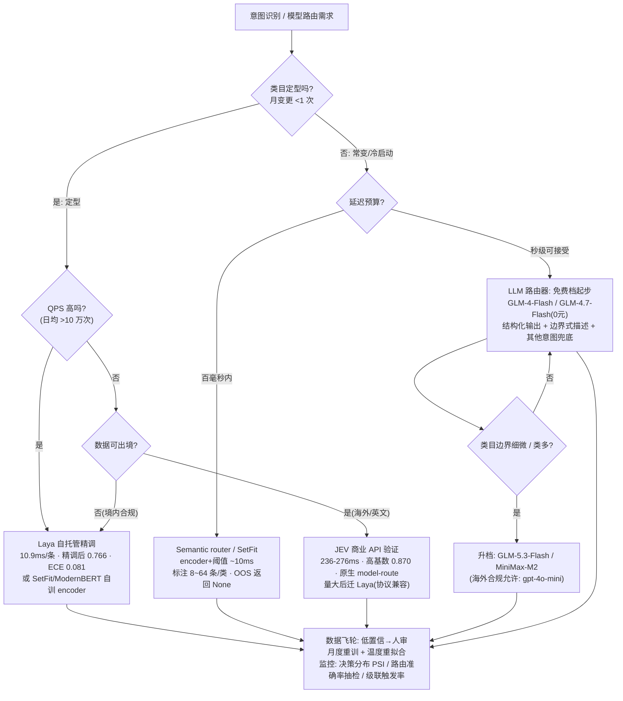

# RAG 意图识别与模型路由

> 版本 v0.1 · 2026-09-27 联网调研 · 适用范围：RAG/Agent 管线中的意图识别（intent classification）与模型路由（model routing）——方法谱系、执行者选型（决策模型 JEV/Laya vs 通用 LLM MiniMax/GLM/ChatGPT）、落地流程与监控。
>
> 依据来源：英文一手（RouteLLM/FrugalGPT/Hybrid LLM/CLINC150/SetFit/semantic-router/官方定价页等 30 项实抓，`research/H`）+ 国内平台与定价（Dify/FastGPT/百炼/DeepSeek/MiniMax/智谱官方页 13 项实抓，`research/I`）+ 本库 jev 方向既有实测（`../jev/01-JEV与Laya深度对比.md`、`../jev/05-未知领域调优与模型路由实战.md`）。价格截至 **2026-09-27**，月级变动。
>
> 条款编号承接（【RG19~24】为 05 篇），本篇为 **【RG25~28】**。

---

## 0. 先把两个问题分开 【RG25.0】

| 问题 | 判断什么 | 输出 | 典型频率 | 决定什么 |
|---|---|---|---|---|
| **意图识别** | 这条 query 想干什么（退款/查订单/闲聊/查数据…） | 类别标签 + 置信度 | 每条用户输入 1 次 | 走哪条链路（哪个知识库/SQL/Web/直答） |
| **模型路由** | 这条请求该由哪个模型处理（简单/复杂、敏感/普通） | 模型档位/决策表命中 | 每条请求 1 次 | 生成端成本与质量 |

两者**经常叠在同一请求上，但执行者可以不同**：意图识别用 ms 级判别模型，模型路由用决策表+置信度；反之亦然。RAG 管线中的完整位置：`query → [意图识别] → [检索策略路由] → 检索 → rerank → [生成模型路由] → 生成`。检索策略路由的证据见 02 §5（Wang et al.：query classification 平均分 0.428→0.443 且延迟 16.4s→11.58s，双赢）、01 §3.6 选型表；本篇聚焦"这两个判断本身用什么做"。

---

## 1. 意图识别：方法谱系与选型 【RG25】

### 1.1 六种方法对比（全部一手数字）

| 方法 | 准确率（代表数字） | 延迟 | 单条成本 | 数据需求 | 适用 |
|---|---|---|---|---|---|
| 规则/正则 | 无统一基准（钓鱼任务上"两行正则 91.8% 胜直问 LLM 62.6%"——社区评测口径 ⚠️） | <1ms | ~0 | 人工写规则 | 第一层粗筛/白名单/高危拦截 |
| **Semantic router**（encoder + cosine 阈值，Aurelio semantic-router） | 依赖阈值调优；低于阈值返回 `None`（天然 OOS 兜底） | **~10ms 级** | 仅 embedding 费 | 每意图十几条例句 | 固定意图、低延迟、无 GPU |
| **SetFit**（few-shot 对比学习微调 encoder） | N=8/类平均 **62.3**，超普通全量微调（43.0）**19.3 分**；RAFT 上 355M 模型 **71.3 超 GPT-3 175B 的 62.7**；训练 30s/$0.025，推理比 T-Few 3B 快 19~123x | ms 级（本地） | ~0 | **8~64 条/类** | 类目定型但标注少——few-shot 首选 |
| 微调 encoder（BERT/ModernBERT/DeBERTa） | CLINC150 全量 SOTA 档；Banking77 77 类上微调 encoder 0.870（Jev） | ModernBERT 比 DeBERTa 快 ~2x，显存 <1/5 | ~0 | 数百~数千条/类 | 大规模固定意图集、追求上限 |
| **LLM zero/few-shot + 结构化输出** | 未进 CLINC150 正榜；RAFT 上 GPT-3 175B 仅 62.7（输给 SetFit 8.6 分） | **100ms~1s** | gpt-4o-mini ≈$0.00005/次；国产免费档 0 元 | 0~几十条示例 | 冷启动、类目常变、原型 |
| 决策模型（Jev/Laya） | Laya 精调 0.766（zero-shot 仅 0.362）；Jev 0.727/高基数 0.870 | Laya 本机 **10.9ms**/T4 32.8ms；Jev API 236–276ms | Laya 自托管≈0；Jev $0.0000084/次 | Laya 需精调（1~2k 标注） | 高频定型微决策、要校准概率 |

来源：SetFit https://arxiv.org/abs/2209.11055 ✅、HF 博客 https://huggingface.co/blog/setfit ✅；CLINC150 https://aclanthology.org/D19-1131/ ✅；ModernBERT https://arxiv.org/abs/2412.13663 ✅；semantic-router https://github.com/aurelio-labs/semantic-router ✅；Jev/Laya 数字见 `../jev/01` §4【官方/三方/实测】。

【RG25.1】**没有"通用最强"，只有"按类目稳定性 × 标注量 × 延迟预算"选**：类目常变/零标注 → LLM；类目定型+标注少 → SetFit；定型+量大 → 微调 encoder 或 Laya 精调；要校准概率做自动门控 → 判别模型（自带每题温度校准）。

【RG25.2】**OOS（out-of-scope）检测才是真正难点**：CLINC150 官方结论——150 个 in-scope 意图分类器"perform well"，但"struggle to identify out-of-scope queries"，低数据下尤甚。**任何意图分类器必须配 OOS 通道**：相似度阈值 / logprobs 门限 / router 返回 None → fail-open 转大模型或人工。来源：https://aclanthology.org/D19-1131/ ✅

【RG25.3】**置信度必须校准才能当门槛**：现代神经网络普遍过度自信，温度缩放（temperature scaling）是"surprisingly effective"的单参数修复（Guo et al. 2017，https://arxiv.org/abs/1706.04599 ✅）；LLM 单 token logprobs 可作置信度但官方明警告"confidence measures certainty, not correctness"（OpenAI Cookbook，https://github.com/openai/openai-cookbook/blob/main/examples/Using_logprobs.ipynb ✅）。置信度来源三件套（成本从低到高）：① 判别模型自带校准概率（Laya 温度拟合后 ECE 0.081）→ ② LLM logprobs → ③ self-consistency/judge（成本 ×N）。

【RG25.4】**用 LLM 做意图分类的正确姿势**（国内三家平台官方口径一致）：① 结构化输出优先——FastGPT 用 function_call 枚举（"系统将其转为 function_call 形式的 Function,模型返回对应的枚举值"，输出天然不会跑偏，要求模型支持工具调用），Dify/百炼用描述式 + `class_name` 映射（模型无关，但依赖描述质量）；② 分类描述写"正例特征 + 反例边界"（Dify 官方："使用「与……相关」「不包括……」等边界表述"；只写类别名 = 让模型猜）；③ 档位按边界细微度选（Dify 官方："简单分类用速度较快的模型即可;分类边界细微时,更强的模型表现更好"）；④ 留"其他意图"兜底分支（百炼默认自带）。来源：https://docs.dify.ai/zh-hans/guides/workflow/node/question-classifier ✅、https://doc.fastgpt.io/docs/introduction/guide/dashboard/workflow/question_classify/ ✅、https://docs.agent.bailian.aliyun.com/zh/flow-agent/applications/workflow/intent-node.md ✅

---

## 2. 模型路由：技术谱系 【RG26】

### 2.1 研究主线（全部一手数字）

| 工作 | 机制 | 关键数字 | 来源 |
|---|---|---|---|
| **RouteLLM**（LMSYS） | 矩阵分解/BERT/causal-LLM 路由器，二选一强/弱模型 | README"省 85% 保 95% GPT-4"是 MT-Bench 上限；**论文 Table 6 精确值：MT-Bench 3.66x（≈73%）@95% 质量，MMLU 仅 1.41x，GSM8K 1.49x**；Arena 偏好数据路由 MMLU 近乎随机，**加 ~1,500 条金标（<2% 训练量）所有 router +20%**；MF router 155 req/s、$1.42/百万请求（开销可忽略） | https://arxiv.org/abs/2406.18665 ✅、https://github.com/lm-sys/RouteLLM ✅ |
| **FrugalGPT** | 级联（便宜模型先答，判分器不满意才升级） | **追平 GPT-4 最多省 98%；同等成本高 4% 准确率** | https://arxiv.org/abs/2305.05176 ✅ |
| **Hybrid LLM** | DeBERTa-v3-large（300M）路由器 | 路由单 query **0.036s**（比 7B LLM 路由器快 200 倍）；最多减 40% 大模型调用质量无显著下降；**强/弱价差越大省越多但风险越大**（大价差对 40% 省 = 10.3% 质量代价）；500 条验证样本即可定阈值 | https://arxiv.org/abs/2404.14618 ✅ |
| **GraphRouter** | task/query/LLM 异构图 + 边预测 | 比现有 router 至少 **+12.3% 质量**；新模型泛化 +9.5% 免重训 | https://arxiv.org/abs/2410.03834 ✅ |
| **RouterBench** | 405k+ 推理结果的 quality-cost 基准 | 没有单一模型全任务最优，路由有真实收益，但 SOTA router 离理论最优前沿尚远 | https://arxiv.org/abs/2403.12031 ✅（注意正确 ID，勿引 2411.12626） |
| **Model Routing Survey** | 8,500+ LLM、2 亿+ 性能记录 | **"model-level scaling"：候选池越大路由越强，可超过池中最佳单模型** | https://arxiv.org/abs/2503.10657 ✅ |

### 2.2 商用与框架内建

- **OpenRouter `:auto`**（免费路由，按被路由到的模型计价）："powered by the wisdom of the market"——按社区近 7 天同类任务实际付费选择模型，`cost_tier` 分档。来源：https://openrouter.ai/auto ✅
- **Not Diamond**：按输入预测模型，官网声称准确率 +5%、成本 −20%。来源：https://notdiamond.ai/ ✅
- **LlamaIndex RouterQueryEngine**：selector 用 LLM 决策（慢路由），典型用法 = **摘要问题 vs 细节问题、向量 vs SQL** 的检索策略路由（`QueryEngineTool` 各带 description）。来源：https://developers.llamaindex.ai/python/framework/module_guides/querying/router/ ✅
- **LangChain `RunnableBranch`**：条件谓词分支（可嵌 embedding 相似度 = 语义路由）；重型条件编排官方建议 LangGraph。✅
- 国内平台：百炼"意图分类节点"（≤60 意图、单/多选、节点级快速/效果思考模式、默认"其他意图"兜底）+ "条件判断节点"（规则式）双轨 ✅；Dify 问题分类器（描述式）✅；FastGPT 分类节点（function_call 枚举）✅。

【RG26.1】**路由收益强依赖流量分布与数据匹配**：同一 RouteLLM 在闲聊分布省 73%、在数学分布只省 33%——先统计自己 query 的难度/类型分布再估收益；路由器必须用自己域内数据训练/校准（通用偏好数据在专业任务上近乎随机）。

【RG26.2】**级联（cascade）优于硬路由**：错路由不可逆，级联"可退回"（弱模型答错→升级重答）；但要把**双跳成本**（重试率×双倍成本+体验损失）计入，且强/弱价差小时级联不划算（Hybrid LLM：小价差对省 40% 仅损 0.2%，大价差对损 10.3%）。

【RG26.3】**路由器自己的开销与可靠性要纳入预算**：MF 路由器开销可忽略（$1.42/百万请求）；**LLM 做路由器 = 每条请求多一次 LLM 往返**（0.1~1s）——高频低价值决策上不划算，这正是 ms 级判别模型/语义路由的生态位。监控三件套：路由决策分布漂移（强/弱占比 PSI）、抽检路由准确率（对拍金标/judge）、级联触发率与重试率。

---

## 3. 执行者选型：JEV vs MiniMax vs GLM vs ChatGPT 【RG27】

### 3.1 先给结论

【RG27.1】**这不是四选一，是"分层 + 分阶段"**——意图识别/路由是"高频、封闭选项、延迟敏感"的小决策，选型判据是五个维度：**延迟预算、数据合规（出境）、成本结构（固定 vs 线性）、零样本 vs 可精调、生态集成**。四类候选的正确位置：

```text
冷启动/验证（今天就能上）  → GLM-4-Flash/GLM-4.7-Flash（免费）或 gpt-4o-mini（海外合规允许时）
国内生产·高频路由流量      → DeepSeek-flash 空闲档 / MiniMax-M2（要吞吐买 highspeed 100 TPS）
生产·高频·定型类目（稳态） → 判别模型：Laya 自托管精调（首选）或自训 encoder；海外英文流量可先 JEV 商业 API 验证
复杂兜底（路由不确定时）   → fail-open 到当档强模型（GLM-5.3/gpt-5 类），不当路由器用
```

### 3.2 逐个分析（为什么、依据是什么）

**JEV（TypeSafe 托管决策模型）**——事实全部来自 `../jev/01`【官方/三方/实测】：
- ✅ 优势：毫秒级封闭决策（商业端点三方实测 p50 236–276ms）、单次决策 ≈$0.0000084、**开箱校准最好**（ECE 0.144）、**高基数选项最强**（Banking77 77 类 0.870，Laya 仅 0.425）、**原生 model-route 端点**（`/api/v1/decisions/model-route` 就是"给任务选模型"的预设）、永不生成文本（物理上无幻觉散文）。
- ❌ 硬伤：**社区 API 限流严格（突发即 429，仅够 PoC）**；商业 Key 与社区 Key 不互通；**闭源黑盒 + state 数据必须出境**（金融/医疗/政务合规大概率直接否决）；国内网络延迟 0.76–1.1s【实测】；中文不顶尖（Laya 官方基准同题对照中文单例 Jev 更准，但无公开中文基准）。
- **结论**：适合海外/英文场景的快速验证与中小流量生产；**国内生产受合规与网络双重限制**——它的正确用法是"先花一天验证'这个决策值不值得上判别模型'，规模化后迁 Laya（`laya-serve` 与商业协议 schema 兼容，改 baseUrl 即切）"。

**MiniMax-M2**——定价 2.1/8.4 元/百万 tokens（缓存读 0.21）、官方标准 ~60 TPS / **highspeed ~100 TPS**、204.8K 上下文（截至 2026-09-27 ✅官方定价页）：
- 定位是**强 agent/生成模型**而非路由器；用于意图识别/路由时是"用大模型档做小决策"，成本比免费档高、延迟为秒级 TTFT+生成——只在"路由与生成合一"（小请求直接让 M2 答，不再分头）的架构里顺手兼任路由。highspeed 档官方承认"路由类高频小决策值得买速度"。

**GLM（智谱）**——**有真免费档**：GLM-4-Flash（0 元，128K）/ GLM-4.7-Flash（0 元，200K）；付费档 GLM-5.3-Flash 0.8/2.8 元（1M 上下文、缓存命中 0.23）、GLM-5.3-FlashX 官方 200 tokens/s（截至 2026-09-27 ✅官方定价页）：
- **国内冷启动首选**：零成本验证意图分类/路由全链路；Dify 等国内平台接入顺畅；按 Dify 官方口径"简单分类用快模型"——免费 Flash 档对常规 RAG 分流（3~10 个粗类目）够用，边界细微（近义意图、10+ 类）再升 GLM-5.3-Flash。
- 注意：GLM-5 上下文长度定价页未标注（勿引用猜测值）；免费档限速与 SLA 以官网为准。

**ChatGPT/OpenAI**——gpt-4o-mini $0.15/$0.60、gpt-5-nano $0.05/$0.40、gpt-5 $1.25/$10（截至 2026-09-27 ✅官方定价页）：
- **生态最强**：structured outputs（json_schema strict）、logprobs 置信度、Cookbook 分类范式（"只返回类名 + top_logprobs"）都是这套——教范式的一手资料基本来自 OpenAI；一次短分类 ≈**$0.00005**（≈0.0006 元）。
- ❌ 两个现实约束：**官方不面向中国大陆提供服务**（直连需合规出境网络，生产通常改 Azure OpenAI 企业协议或国产替代；信创场景直接排除）；延迟 100ms~1s 做路由器偏慢。
- **结论**：范式与 prompt 工程的一等参考；生产执行者在国内容易被合规否决，海外团队可用 gpt-4o-mini/gpt-5-nano 做意图档。

**（必须同场加映）Laya**——JEV 的开源同构替身（`../jev/01`）：
- 本机 RTX 5060 Ti 实测单决策 **p50 10.9ms**、自托管零 token 成本、精调后 typed-decisions 0.766（zero-shot 仅 0.362，**能力来自精调**）、温度拟合后 ECE 0.081（校准可做自动化门槛）、Apache 2.0 可私有化；短板：中文不顶尖（MASSIVE zh-CN 0.62–0.63，**生产前必须自建评测集+精调**）、高基数弱、CPU 慢（193–464ms）。
- **生产高频稳态的正解**：日均 10 万+ 次定型决策、数据不能出境 → Laya 精调（1~2k 标注、单卡数小时，见 `../jev/05` §2）或 SetFit/ModernBERT 自训。

【RG27.2】**"用 LLM 做路由器"的根本性账**：路由器本身每条请求多一次 LLM 往返（国产 API 实际 0.5~2s，本库 jev 方向实测本地网关生成 1.7–6.7s 量级）；判别模型 10~40ms。**当路由决策的 QPS 接近业务主流量时，路由器必须换成 ms 级执行者**；LLM 路由器只该出现在"低频 + 需要理解长上下文才能判难度"的场景（如 agent 内判断任务复杂度）。

【RG27.3】**决策模型（JEV/Laya）与微调 encoder 的边界**：小类目（≤20 选项）两者都行，Laya 更快更省更可审计；**高基数（>20 选项）JEV/微调 encoder 强、Laya 架构性弱**（token 预算摊薄）；要概率校准 → 判别模型自带温度校准 vs encoder 需自己补温度拟合（Guo 2017）。jev/05 §5.6 的三坑（零样本路由器=没有路由器、双跳成本、域漂移回退）在选 Laya/JEV 时同样适用。

### 3.3 选型决策树



【RG27.4】**一句话回答**：常规 RAG 意图分流**不要在四个名字里单选**——用"免费 LLM 档（GLM-4-Flash）冷启动 → 类目定型后 SetFit/判别模型（Laya）接盘 → 复杂兜底 fail-open 到当档强模型"的分层路径；JEV 适合海外英文场景验证与高基数决策（国内受合规/网络限制），MiniMax/GLM/ChatGPT 都是"LLM 路由器"档位的候选（GLM 有免费档国内首选、MiniMax 胜在高吞吐档、ChatGPT 胜在生态但国内难合规），它们的共同短板是"每条请求多一次秒级往返"，QPS 一高就必须换成判别模型。

---

## 4. 落地流程与监控 【RG28】

### 4.1 从冷启动到稳态（承接 `../jev/05` 五阶段，此处只列分叉点）

1. **阶段 0（定义决策面）**：意图/路由标签体系 + 每类正反例边界 + "其他"兜底——jev/05 §阶段0 的判别力探针（50~200 条种子样本 zero-shot ≥60% 才继续）对 LLM 路由同样适用（探针直接用免费档跑）。
2. **阶段 1~2（标注与基线）**：LLM 预标注 + 人工校对（kappa≥0.7）；三基线（多数类/规则/LLM few-shot）必须被打败才上线。
3. **阶段 3（精调/蒸馏）**：路径 A——SetFit（8~64 条/类，30s 训练）；路径 B——Laya 精调（1~2k 软标签标注，单卡数小时）；**上线前温度拟合 + held-out 评测（ECE）**。
4. **阶段 4（上线与飞轮）**：shadow → 灰度 5%→100%；阈值从成本函数推导（jev/05 §4.3 公式：p_err < C_h/L 才自动化）；低置信 fail-open 决策表（jev/05 §5.2）。
5. **双路由层组合**：第一层 ms 级（semantic router/SetFit/判别模型）定意图与检索策略 + OOS 拦截；第二层按需（RouteLLM 类或决策表）定生成模型档位；两层各配监控。

### 4.2 检查单（12 条）

- [ ] 意图描述含正例+反例边界（"不包括……"），留"其他"兜底分支
- [ ] LLM 分类用结构化输出（function_call 枚举优先）；置信度来自 logprobs 或校准概率，且经过验证集校准
- [ ] OOS 通道存在：阈值/None/logprobs 门限 → fail-open 转大模型或人工
- [ ] 先统计 query 难度/类型分布再估路由收益（强弱档价差、可下放比例）
- [ ] 路由器用域内数据训练/校准（通用偏好数据在专业任务上近乎随机）
- [ ] 级联而非硬路由；双跳重试成本计入 ROI
- [ ] 高 QPS 场景路由器为 ms 级执行者（非 LLM）；LLM 路由器只用于低频复杂判断
- [ ] 精调后温度拟合 + ECE 报告；门控阈值从成本函数推导
- [ ] shadow mode ≥1 周再灰度；D 日/大促冻结变更
- [ ] 监控：路由决策分布 PSI、路由准确率抽检（金标/judge 对拍）、级联触发率、重试率
- [ ] 域漂移预案：PSI 突变自动回退"全强模型"兜底；月度流量回放重定阈值
- [ ] 选型把"权限功能/模型生命周期"纳入（Jev 双 Key 体系、模型下线、定价变动——见 05 §7 漂移教训）

---

## 5. 参考资料

本篇全部来源（30+13 项官方实抓 + 15 项社区线索）与逐条核验状态：`research/H-意图识别与模型路由.md`、`research/I-意图识别与路由-中文与价格.md`；汇总清单见同目录《04-参考资料.md》§12。决策模型侧深度内容（RLCD 原理、精调配方、路由三坑、成本敏感阈值）见 `../jev/01-JEV与Laya深度对比.md`、`../jev/05-未知领域调优与模型路由实战.md`，本篇不重复。
